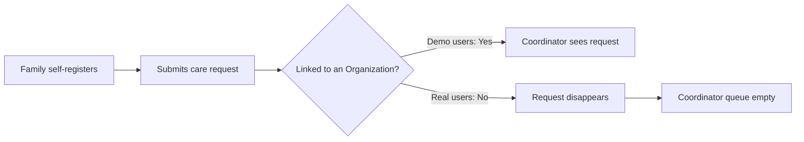
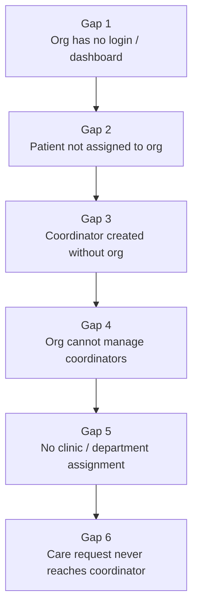
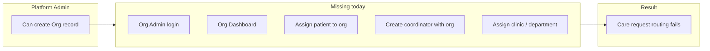
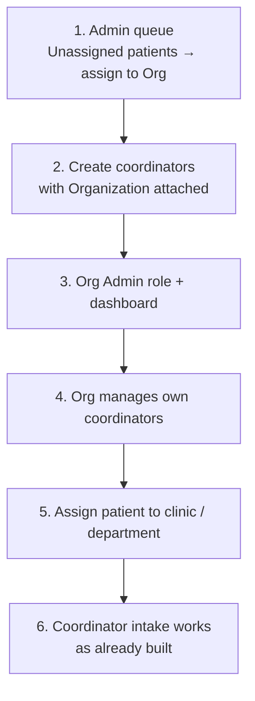
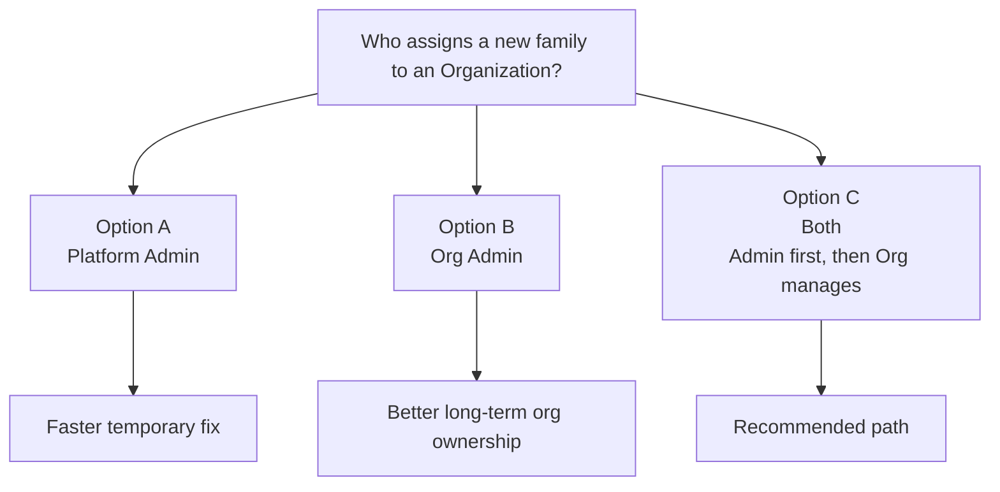

# Organization Flow — Gaps & Loopholes

**Prepared:** 2026-07-24  
**Updated:** 2026-07-30 — client-call Mermaid diagrams added  
**Purpose:** Internal pitch document — gaps discovered during M3 testing that need to be addressed before the org/coordinator flow can work end-to-end.

---

## Client Call Diagrams

Use these diagrams when explaining the issue to the client.

### 1. The problem in one picture

**Talking point:**  
Demo works because users are already linked to an organization. Real signups are not, so the care request never reaches a coordinator.

### 2. Current broken flow vs correct flow

```mermaid
flowchart TB
  subgraph TODAY["TODAY — Broken for real users"]
    A1[Family registers] --> A2[No organization assigned]
    A2 --> A3[Care request submitted]
    A3 --> A4[Looks successful]
    A4 --> A5[Coordinator never sees it]
  end

  subgraph NEEDED["NEEDED — Correct flow"]
    B1[Family registers] --> B2[Admin or Org Admin assigns to Organization]
    B2 --> B3[Assign clinic / department]
    B3 --> B4[Route to Coordinator]
    B4 --> B5[Coordinator intake queue]
    B5 --> B6[Care episode / M3 flow continues]
  end
```

### 3. The 6 gaps as a chain

### 4. Who is missing from the system

### 5. What we need to build (priority discussion)

### 6. Decision for client

---

## Background

During M3 testing, a patient account (`shahbaztayyab1386@outlook.com`) was created via self-registration. The patient's care request never appeared in the coordinator's intake queue. The root cause: the patient's account had no `organizationId`, so the system could not route the request to any organization or coordinator. This investigation revealed that the problem is not a single bug — it is a missing layer of the system entirely.

---

## Gap 1 — Organizations Have No Login and No Dashboard

**What exists:** Admin can create an organization record (name, address, etc.) in the database.  
**What is missing:** There is no `org_admin` user role. There is no dashboard for organizations. There is no way for anyone representing an organization to log in, view their patients, manage their coordinators, or take any action at all.

Organizations are currently just database records. They cannot participate in the system.

**Impact:** Every feature that is supposed to be "org-managed" is either blocked or has to be done manually by the platform admin.

---

## Gap 2 — Patients Are Not Assigned to an Organization After Registration

**What exists:** Patients self-register. The registration endpoint creates an account with `organizationId = null`.  
**What is missing:** There is no flow — in the admin panel or anywhere — for an admin to assign a newly registered patient to an organization.

When the system routes care requests, it filters episodes by `organizationId`. A patient with no org assigned is invisible to every coordinator and every org.

**Proposed flow (not yet built):**
1. Patient self-registers → request sits in an "unassigned" admin queue
2. Admin reviews and assigns the patient to the appropriate org
3. Patient's care request then becomes visible to that org

---

## Gap 3 — Coordinators Are Not Linked to Any Organization

**What exists:** The admin can create a coordinator via the staff management screen. The coordinator is created with `organizationId = null`.  
**What is missing:** The coordinator creation endpoint does not accept or set an `organizationId`. No coordinator in the system currently belongs to any org.

The coordinator picker (used when assigning a coordinator to a care episode) filters by organization. Because all coordinators have `organizationId = null`, the picker returns nothing — even if the admin manually assigned a patient to an org.

**Impact:** The coordinator assignment step is broken for any real account. It only works in testing when `organizationId` is manually patched in the database.

---

## Gap 4 — Organizations Cannot Manage Their Own Coordinators

**What exists:** Only the platform admin can create coordinators, via `/admin/staff`.  
**What is missing:** There is no endpoint or interface for an organization to add, view, or remove coordinators from their own pool.

Ahmed's requirement states: *"The system must support multiple coordinators, allowing the organization to add more as it grows."* This is entirely unimplemented. The organization has no mechanism to grow its coordinator team — every addition requires a platform admin to do it manually, with no org context set.

---

## Gap 5 — No Flow for Org to Assign Clinic or Department to a Patient

**What exists:** Admin can create clinics and departments under an organization.  
**What is missing:** There is no flow for anyone (org or admin) to assign a patient to a specific clinic or department within their org. The care episode creation form requires a `careUnitId` (clinic/department), but there is no guided step that tells a patient or coordinator which care unit to use.

If the patient picks the wrong care unit (or none exists for their org), the episode either fails to create or gets silently scoped to the wrong org.

---

## Gap 6 — Self-Registered Care Requests Never Reach Coordinators

This is the visible symptom of Gaps 1–5 combined — what the family and the care team actually experience.

**How routing works today:** the coordinator intake queue only shows care requests (intakes) that share the same organization as the logged-in coordinator. If the family’s account, care unit, or intake has no organization, that request is never listed for any coordinator.

**What happens in a real signup (not seed/demo data):**
1. Family self-registers → account has no organization.
2. They create a care unit and submit a care request → the request also has no organization.
3. The family sees a successful submit. There is **no error** telling them the request cannot be routed.
4. Coordinators in any organization never see that request. From the family’s point of view, the request disappears into a black hole.

**Why demos looked fine:** seeded demo coordinators and demo families are pre-linked to an organization in the database. That linkage is not created by the live registration or “add staff” product flows. New real users do not get it.

**Impact for go-live:** without an organization join/assignment step (Gaps 1–5), every organic family signup produces an invisible care request. The platform appears to accept the request while the care team has nothing to act on.

---

## Summary Table

| # | Gap | Who is affected | Severity |
|---|-----|----------------|----------|
| 1 | No org dashboard or login | Organizations | Critical |
| 2 | Patients not assigned to org after registration | Patients, Admin | Critical |
| 3 | Coordinators created without an org link | Coordinators | Critical |
| 4 | Orgs cannot manage their own coordinators | Organizations | High |
| 5 | No flow for org to assign clinic/department to patient | Organizations, Coordinators | High |
| 6 | Self-registered care requests never reach coordinators | Families, Coordinators | Critical (end result of 1–5) |

---

## Proposed Correct Flow

This is the flow that should exist once the above gaps are closed:

1. **Patient self-registers** → account created with `organizationId = null`, status = pending assignment
2. **Admin reviews unassigned patients** → assigns each patient to the appropriate organization
3. **Org admin logs in** (requires new `org_admin` role + dashboard) → sees their assigned patients
4. **Org assigns patient to a clinic/department** within their organization
5. **Org assigns or auto-routes care request to one of their coordinators**
6. **Coordinator sees the request in their intake queue** and begins the episode workflow
7. Everything from coordinator intake onward works as currently built

Steps 1–5 are either partially built or entirely missing. Step 6 onward is implemented but unreachable due to the gaps above.

---

## What Needs to Be Built

- `org_admin` user role with its own login flow and dashboard
- Admin screen: unassigned patient queue + org assignment action
- Coordinator creation updated to require and store `organizationId`
- Org-level coordinator management (add/list/remove their own coordinators)
- Org-level flow to assign patients to clinics/departments
- Optionally: auto-routing rules so the org doesn't have to manually assign every request
