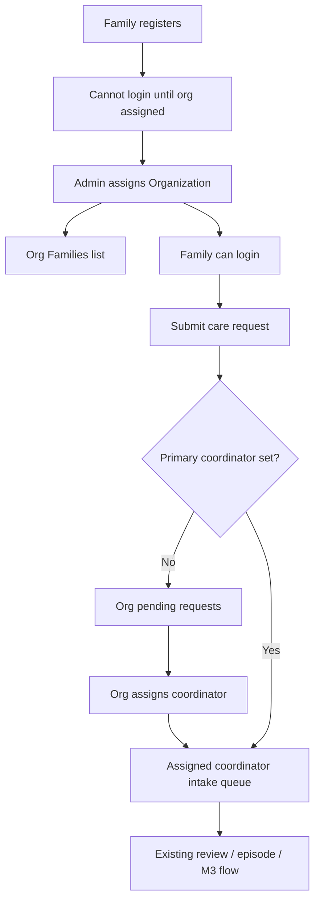

# Organization Flow — Gaps & Loopholes

**Prepared:** 2026-07-24  
**Updated:** 2026-07-30 — assigned-only intake **implemented and manually verified**  
**Purpose:** Track org/family/coordinator onboarding gaps and the decided product flow.

---

## Status

| Item | State |
|------|--------|
| Product flow (assigned-only) | ✅ Shipped |
| End-to-end smoke | ✅ Passed (manual, 2026-07-30) |
| Clinic / department assignment | ⏭ Out of this pass |

---

## Implemented flow (assigned-only)

**Rules**
- Visibility of **pending** requests without a primary coordinator: **org admin only**
- After assignment: **that coordinator only** (not all org coordinators)
- Family login is blocked while `organizationId` is null
- Coordinators do **not** assign/reassign other coordinators (org admin owns that)

**Also shipped with this pass**
- Magic-link set-password for org admin / coordinator invites → role-specific login portal
- Email to family when org is assigned (`/login?portal=family`)
- Email to coordinator when assigned as primary for a family
- Sidebar attention badges (Admin Families unassigned; Org pending / families / coordinators; Coord intake queue)
- Refresh on Admin Families, Org Families / Pending / Coordinators

---

## Smoke checklist (verified ✅)

1. ✅ Admin creates org (email + admin name) → magic link → `/set-password` → `/login?portal=org`
2. ✅ Family self-registers → login returns awaiting organization assignment
3. ✅ Admin → Families → assign org → family emailed + can log in
4. ✅ Org → Coordinators → invite → magic link → `/login?portal=coordinator`
5. ✅ Family submits intake without assigned coordinator → **Org → Pending requests**
6. ✅ Org assigns coordinator → request appears on **that** coordinator’s intake queue only
7. ✅ Coordinator reviews intake → episode / M3 path continues (no coord-to-coord assign UI)

### Demo logins (after seed)

| Role | Email | Path |
|------|-------|------|
| Org Admin | `orgadmin@riayahplus.com` | `/org` |
| Coordinator | `coordinator@riayahplus.com` | `/coordinator` |
| Family | `family@demo.com` | `/family` |
| Family B | `family.b@demo.com` | `/family` |

Password: `Password123!`

---

## Historical gaps (status)

| # | Gap | Status |
|---|-----|--------|
| 1 | No org dashboard / login | ✅ Addressed (`org_admin` + `/org`) |
| 2 | Patients not assigned to org | ✅ Addressed (Admin Families) |
| 3 | Coordinators created without org | ✅ Addressed (Org invite path) |
| 4 | Orgs cannot manage coordinators | ✅ Addressed |
| 5 | Clinic/department assignment | ⏭ Out of this pass |
| 6 | Care request never reaches care team | ✅ Addressed via org pending → assigned coordinator |
