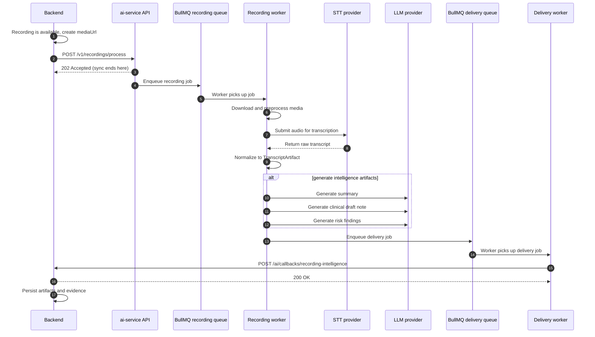
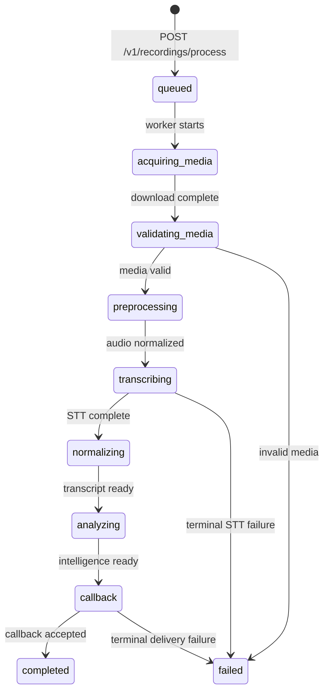

# Recording Intelligence Backend Integration Specification

> **Audience:** Riayah Plus Backend engineering team (no access to `ai-service`
> source code required)<br>
> **Scope:** HTTP contract between the Backend and `ai-service` for recording
> transcription and draft clinical intelligence

<!-- prettier-ignore -->
> [!IMPORTANT]
> **Contract version:** Recording Intelligence Backend Integration v1<br>
> **ai-service verified baseline:** `dc2ba65dc06eaec79681fd897328eceb5e45d6f1`<br>
> **Official container image:**
> `acrriayahaiuaenorth.azurecr.io/riayah-ai-service:dc2ba65dc06eaec79681fd897328eceb5e45d6f1`<br>
> **Verified environment:** staging<br>
> **Status:** Implemented and black-box validated

This document is the definitive, self-contained Backend-facing API contract for
Riayah Plus AI Recording Intelligence. It describes how the Backend triggers
processing, authenticates requests, receives asynchronous callbacks, parses the
multi-artifact result, and persists it safely.

## 1. Contract metadata

| Item | Value |
|---|---|
| Document title | Recording Intelligence Backend Integration Specification |
| Contract version | v1 |
| Verified `ai-service` commit | `dc2ba65dc06eaec79681fd897328eceb5e45d6f1` |
| Verified container image | `acrriayahaiuaenorth.azurecr.io/riayah-ai-service:dc2ba65dc06eaec79681fd897328eceb5e45d6f1` |
| Verified environment | Staging |
| Validation status | Black-box E2E passed |
| Staging base URL | `https://ca-riayah-ai-staging.yellowcoast-06b87bcc.uaenorth.azurecontainerapps.io` |
| Process endpoint | `POST /v1/recordings/process` |
| Callback endpoint | `POST /ai/callbacks/recording-intelligence` |
| Delivery mode | `intelligence` |
| Verified worker concurrency | `2` |

## 2. High-level responsibility boundary

`ai-service` is stateless. The Backend owns persistence, versioning, and
clinical authority. `ai-service` performs these steps:

1. Accepts a recording process request.
2. Downloads and preprocesses the media file.
3. Transcribes audio through the configured STT provider.
4. Generates a structured transcript artifact.
5. Runs summary, clinical draft note, and risk analysis independently.
6. Delivers the result to the Backend callback endpoint.

The Backend performs these steps:

1. Creates or obtains a usable media URL.
2. Calls `POST /v1/recordings/process`.
3. Implements `POST /ai/callbacks/recording-intelligence`.
4. Authenticates inbound callbacks.
5. Persists artifacts and resolves evidence references.
6. Surfaces draft content for clinician review.

## 3. Complete end-to-end sequence

The following Mermaid sequence diagram shows the full flow. The synchronous HTTP
request ends at the `202 Accepted` response. Everything after that is
asynchronous.



The state transition below shows how a recording job moves through the pipeline.
Backend does not drive these states, but the vocabulary is useful for logging
and UI.



## 4. Environment / base URL

The staging base URL is:

```text
https://ca-riayah-ai-staging.yellowcoast-06b87bcc.uaenorth.azurecontainerapps.io
```

All paths in this document are relative to the configured base URL. The Backend
can expect the same endpoint shapes in production; only the base URL and secrets
change.

## 5. Backend → AI authentication

Every request to `POST /v1/recordings/process` must include the shared API key.

| Item | Value |
|---|---|
| Header name | `X-API-Key` |
| Header value | Shared secret configured in `ai-service` as `AI_SERVICE_API_KEY` |
| Missing or invalid key | `401 Unauthorized` |
| Pipeline disabled | `503 Service Unavailable` |

Never log the key, never expose it in client-side code, and never include it in
documentation examples.

## 6. Process API: complete specification

### Endpoint

```text
POST /v1/recordings/process
```

### HTTP semantics

- The request body is JSON.
- The response is always JSON.
- A successful acceptance returns `202 Accepted`.
- A duplicate completed job returns `200 OK`.
- A duplicate failed job returns `409 Conflict`.
- The response is an acknowledgement only. It is not the final transcript or
  intelligence result.

## 7. Request field reference

| Field | Type | Required | Nullable | Meaning | Example | Constraints |
|---|---|---|---|---|---|---|
| `recordingId` | `string` | yes | no | Backend domain identifier for the recording. | `"recording_2026_001"` | Must be stable across retries. |
| `sourceType` | `string` | yes | no | Media-source strategy. | `"mixed"` | Allowed: `mixed`, `participant`, `track`. |
| `mediaUrl` | `string` | yes | no | URL `ai-service` can `GET` to download the recording. | `"https://backend.example.internal/api/v1/recordings/..."` | Must be HTTP(S). Must remain valid until the worker downloads it. |
| `sessionId` | `string` | no | yes | Optional session context. | `"session_01J8XYZ123"` | Should equal `recordingId` for telehealth sessions. |
| `meetingId` | `string` | no | yes | Optional meeting context. | `null` |  |
| `participantId` | `string` | no | yes | Optional participant identity for track/participant sources. | `null` | Not used for `mixed`. |
| `participantRole` | `string` | no | yes | Optional participant role for track/participant sources. | `null` | Not used for `mixed`. |
| `pipelineVersion` | `string` | yes | no | Opaque pipeline name supplied by Backend. | `"2026-09-recording-v1"` | Used for idempotency. |
| `languageHint` | `string` | no | yes | Hint for transcription and output language. | `"en"` | Arabic is selected when the value is `"ar"` or starts with `"ar_"`. |
| `timing` | `object` | no | yes | Optional timing metadata. | `{ "startedAtMs": ..., "endedAtMs": ..., "durationMs": ... }` | See section 46. |
| `metadata` | `object` | no | no | Opaque key/value bag passed through. | `{}` | Extra top-level fields are rejected. |

`outputLanguage` is not a request field. Output language is resolved by
`ai-service` from `RECORDING_DEFAULT_OUTPUT_LANGUAGE` and `languageHint`.

## 8. sourceType

The `sourceType` field tells `ai-service` how to interpret the media source.

| Value | Meaning | When to use |
|---|---|---|
| `mixed` | Single mixed audio from a room composite. | Current production default. Use this for LiveKit room recordings. |
| `participant` | Audio tied to one participant. | Reserved for future identity-preserving flows. |
| `track` | Audio tied to one media track. | Reserved for future identity-preserving flows. |

For `mixed`, speaker labels such as `S1` and `S2` are inferred through
diarization. For `participant` and `track`, attribution would be deterministic.

## 9. mediaUrl contract

`mediaUrl` must meet these requirements:

- It must be an HTTP or HTTPS URL.
- It must be reachable from `ai-service`.
- It must remain valid until the recording worker downloads the file.
- A `202 Accepted` response does not mean the media has already been downloaded.
- Queue depth and worker load can delay download by seconds or longer.
- `ai-service` supports presigned URLs, but the Backend is responsible for
  choosing a lifetime that covers queue wait plus retry windows.

The current media size guardrail is 500 MB. Larger files are rejected with a
callback failure.

## 10. pipelineVersion

`pipelineVersion` is the Backend-controlled idempotency key. It is opaque to
`ai-service` except for these transformations:

- Dots `.` are replaced with hyphens `-`.
- Spaces ` ` are replaced with underscores `_`.

This produces the `safePipelineVersion` used inside the BullMQ job ID.

Rules for `pipelineVersion`:

- Reuse the same value for retries of the same logical processing run.
- Do not invent a new value because an HTTP call timed out.
- Change the value only for deliberate reprocessing, for example after a
  terminal failure or a pipeline upgrade.
- Preserve the value alongside every persisted artifact and evidence reference.

## 11. Job ID

The deterministic job ID is:

```text
recording:{recordingId}:{safePipelineVersion}
```

where:

```text
safePipelineVersion = pipelineVersion.replace(".", "-").replace(" ", "_")
```

Example:

```text
recording:recording_2026_001:2026-09-recording-v1
```

Backend can reproduce this ID for logging and reconciliation, but it does not
need to construct or parse it for normal operation. The callback includes
`jobId`.

## 12. First process request: exact HTTP example

```http
POST /v1/recordings/process HTTP/1.1
Host: ca-riayah-ai-staging.yellowcoast-06b87bcc.uaenorth.azurecontainerapps.io
Content-Type: application/json
X-API-Key: <REDACTED>

{
  "recordingId": "recording_2026_001",
  "sourceType": "mixed",
  "mediaUrl": "https://backend.example.internal/api/v1/recordings/recording_2026_001/media?token=REDACTED",
  "sessionId": "session_01J8XYZ123",
  "meetingId": null,
  "participantId": null,
  "participantRole": null,
  "pipelineVersion": "2026-09-recording-v1",
  "languageHint": "en",
  "timing": {
    "startedAtMs": 1726917600000,
    "endedAtMs": 1726918057000,
    "durationMs": 457000
  },
  "metadata": {
    "sessionId": "session_01J8XYZ123",
    "requestedBy": "backend_worker"
  }
}
```

curl equivalent:

```bash
curl -s -X POST \
  "https://ca-riayah-ai-staging.yellowcoast-06b87bcc.uaenorth.azurecontainerapps.io/v1/recordings/process" \
  -H "Content-Type: application/json" \
  -H "X-API-Key: $AI_SERVICE_API_KEY" \
  -d @docs/examples/recording-intelligence/process-request.json
```

## 13. Immediate response: new job

For a fresh request, `ai-service` returns:

```http
HTTP/1.1 202 Accepted
Content-Type: application/json

{
  "recordingId": "recording_2026_001",
  "jobId": "recording:recording_2026_001:2026-09-recording-v1",
  "status": "queued",
  "pipelineVersion": "2026-09-recording-v1",
  "reused": false,
  "message": "Recording transcription job queued for processing."
}
```

`status` can be `queued` for any non-terminal existing job. The exact BullMQ
state is collapsed into a stable API vocabulary.

## 14. Existing / reused job responses

If the same `recordingId + pipelineVersion` is submitted again, `ai-service`
returns the existing job state and does not rerun provider work.

| Existing job state | HTTP status | `status` | `reused` | Backend action |
|---|---|---|---|---|
| Queued, active, or waiting | `202` | `queued` | `true` | Wait for callback. |
| Completed | `200` | `completed` | `true` | Processing is done. Check your own stored artifacts; if no result is present, treat as a delivery/reconciliation case, not a reason to create a new `pipelineVersion`. |
| Failed | `409` | `failed` | `true` | Do not retry the same pair. Investigate and use a new `pipelineVersion` only after fixing the root cause. |

## 15. Important: processing completed != callback received

A `200 OK` reused response means `ai-service` finished processing. It does not
guarantee the Backend callback was delivered or persisted successfully.

The callback may be:

- Already delivered and accepted.
- In the delivery queue waiting for a slot.
- Retrying after a network error, timeout, or `5xx` response.
- Terminally failed because the Backend returned a non-retryable `4xx` response.

Backend must check its own stored artifacts to know whether it has the result.

## 16. Missing callback recovery

If Backend receives `202 Accepted` but the callback never arrives:

1. Do not create a new `pipelineVersion` to force reprocessing.
2. Retry the same `POST /v1/recordings/process` with the same `recordingId` and
   `pipelineVersion`.
3. `ai-service` returns the current job state:
   - `202` / `status=queued`: still in progress.
   - `200` / `status=completed`: processing finished; check your own stored
     artifacts before deciding the callback is missing.
   - `409` / `status=failed`: processing failed terminally.

This retry is a safe status/recovery operation. It does not start new provider
work.

## 17. Error response matrix

| Status | When it happens | Backend action |
|---|---|---|
| `400 Bad Request` | Terminal error raised before the job is accepted. | Fix the request payload before retrying. |
| `401 Unauthorized` | Missing or invalid `X-API-Key`. | Check the shared secret and header. |
| `409 Conflict` | Existing job for this `recordingId + pipelineVersion` has already failed. | Do not retry blindly. Resolve the cause and reprocess under a new `pipelineVersion` only if appropriate. |
| `422 Unprocessable Entity` | Request body fails schema validation (wrong type, missing field, extra field). | Fix the payload and retry. |
| `502 Bad Gateway` | `ai-service` could not enqueue the job on Redis/BullMQ. | Retry with backoff. |
| `503 Service Unavailable` | Recording pipeline is disabled (`RECORDING_PIPELINE_MODE=disabled`). | Do not retry until the pipeline is enabled. |

## 18. Asynchronous queue semantics

Recording processing runs on a dedicated BullMQ queue consumed by recording
workers. Delivery runs on a separate BullMQ queue consumed by delivery workers.

Key queue settings from code:

| Setting | Default | Notes |
|---|---|---|
| Recording job attempts | `3` | Retryable processing errors are retried here. |
| Recording job backoff | `1000 ms` fixed | Configurable. |
| Recording worker concurrency | `1` | Staging verified at `2`. |
| Delivery job attempts | `5` | Only delivery retries, never provider reruns. |
| Delivery job backoff | `2000 ms` exponential | Configurable. |
| Delivery timeout | `30 s` | Backend should respond quickly. |

Backend does not manage these queues. It only calls the process endpoint and
implements the callback.

## 19. Observed latency: not SLA

The numbers below are observed staging samples, not guarantees or timeout
requirements.

### Final E2E sample

- Fixture: `PriMock57 day1_consultation01_mixed.wav`
- Duration: ~457.92 s

| Step | Observed time |
|---|---|
| API acknowledgement | ~0.335 s |
| Media download | ~5.99 s |
| Preprocess | ~0.24 s |
| Speechmatics transcription | ~99.71 s |
| Summary generation | ~6.51 s |
| Clinical draft note generation | ~8.86 s |
| Risk generation | ~0.74 s |
| Delivery | ~0.1 s |
| Total POST to callback | ~123 s |

### Artifact counts from final E2E

| Artifact | Counts |
|---|---|
| Transcript | 242 segments |
| Summary | 10 key points, 44 evidence refs, model `deepseek-flash`, promptVersion `v3`, 10775 total tokens |
| Clinical draft note | 8 sections, 86 evidence refs (81 unique), model `deepseek-flash`, promptVersion `v3`, 2680 completion tokens, finish reason `stop`, max tokens `8000` |
| Risk | 0 findings, model `deepseek-flash`, promptVersion `v2`, 8855 total tokens |

Actual latency depends on audio length, queue depth, worker concurrency,
provider latency, network conditions, retries, and transcript complexity. Do not
assume linear scaling with recording duration.

## 20. Callback endpoint Backend must implement

`ai-service` POSTs results to:

```text
POST /ai/callbacks/recording-intelligence
```

The Backend owns this endpoint. It must:

- Accept JSON.
- Authenticate the caller.
- Accept duplicate deliveries.
- Persist artifacts idempotently.
- Return a suitable HTTP status code.

The path is configurable in `ai-service` through
`RECORDING_INTELLIGENCE_CALLBACK_PATH`, but the default and verified path is
`/ai/callbacks/recording-intelligence`.

## 21. AI → Backend callback headers

Every callback attempt includes these headers:

| Header | Value | Purpose |
|---|---|---|
| `Content-Type` | `application/json` | Request body format. |
| `Accept` | `application/json` | Expected response format. |
| `X-API-Key` | Shared secret from `BACKEND_API_KEY` | Authenticates `ai-service` to Backend. |
| `X-Request-Timestamp` | Unix timestamp in seconds | Rejects stale requests. |
| `X-Nonce` | UUID hex string | Prevents replay of the same HTTP attempt. |

`X-Request-Timestamp` and `X-Nonce` are regenerated on every delivery attempt,
including retries. They are not business idempotency keys.

## 22. Callback response expectation

Backend must respond as follows:

| Backend response | ai-service behavior |
|---|---|
| `2xx` | Mark delivery as successful. |
| `429` | Retry with exponential backoff (delivery only). |
| `5xx` | Retry with exponential backoff (delivery only). |
| `400`, `401`, `403`, `404`, `422`, other `4xx` | Terminal: stop retrying. |

Backend should return `200 OK` as soon as the payload is accepted and
persisted. Heavy downstream work should be deferred to a background job.

## 23. Complete callback top-level schema

| Field | Type | Required | Meaning |
|---|---|---|---|
| `recordingId` | `string` | yes | Same `recordingId` from the request. |
| `jobId` | `string` | yes | Deterministic BullMQ job ID. |
| `pipelineVersion` | `string` | yes | Same `pipelineVersion` from the request. |
| `status` | `string` | yes | `completed` or `failed` at the processing-run level. |
| `outputLanguage` | `string` | yes | Language of human-readable content, for example `en` or `ar`. |
| `analysisStrategy` | `string` | yes | `single_pass` or `hierarchical`. |
| `artifacts` | `object` | yes | Map of artifact wrappers: `transcript`, `summary`, `clinicalDraftNote`, `risk`. |

Example top-level envelope:

```json
{
  "recordingId": "recording_2026_001",
  "jobId": "recording:recording_2026_001:2026-09-recording-v1",
  "pipelineVersion": "2026-09-recording-v1",
  "status": "completed",
  "outputLanguage": "en",
  "analysisStrategy": "single_pass",
  "artifacts": {
    "transcript": { "status": "completed", "artifact": { ... } },
    "summary": { "status": "completed", "artifact": { ... } },
    "clinicalDraftNote": { "status": "completed", "artifact": { ... } },
    "risk": { "status": "completed", "artifact": { ... } }
  }
}
```

## 24. Artifact wrapper contract

Every artifact slot uses the same wrapper shape:

| Field | Type | Required | Meaning |
|---|---|---|---|
| `status` | `string` | yes | `completed`, `failed`, or `skipped`. |
| `artifact` | `object` | no | Present when `status=completed`. The concrete artifact object. |
| `errorCode` | `string` | no | Present when `status=failed`. Machine-oriented error class. |
| `errorMessage` | `string` | no | Present when `status=failed`. Human-readable, non-sensitive message. |

The wrapper must not contain a nested `artifact.artifact` path. The correct
paths are:

```text
artifacts.transcript.artifact.segments
artifacts.summary.artifact.keyPoints
artifacts.clinicalDraftNote.artifact.sections
artifacts.risk.artifact.findings
```

## 25. Top-level status vs artifact status

`status` at the top level describes the whole processing run. Artifact wrappers
have their own `status`.

| Top-level status | Meaning |
|---|---|
| `completed` | Processing reached the end. Individual artifacts may still be `failed` or `skipped`. |
| `failed` | Processing failed terminally before producing usable artifacts. Every artifact wrapper is `failed`. |
| `partial` | Some artifacts succeeded and some failed. The top-level status may still be `completed` if the run reached the delivery stage. |

A failed Summary does not invalidate a completed ClinicalDraftNote or Risk.
However, if the transcript fails, derived artifacts cannot be produced and all
artifact statuses become `failed`.

## 26. Transcript artifact: complete field reference

`artifacts.transcript.artifact` has this structure:

| Field | Type | Required | Meaning |
|---|---|---|---|
| `language` | `string` | no | Resolved language, for example `en` or `ar`. |
| `completeText` | `string` | no | Full concatenated transcript text. |
| `segments` | `array` | yes | Ordered `TranscriptSegment` objects. |
| `attributionMode` | `string` | yes | `inferred` for mixed audio; `deterministic` for participant/track sources. |
| `isDraft` | `boolean` | yes | Always `true`. |
| `reviewStatus` | `string` | yes | `draft`, `reviewed`, or `approved`. Currently always `draft`. |
| `warnings` | `array` | yes | Human-readable warnings, for example source gaps. |
| `gaps` | `array` | yes | Detected transcript gaps. Each gap has `startMs`, `endMs`, `durationMs`, and `reason`. |
| `providerMetadata` | `object` | yes | Provider-specific metadata such as provider name, model, domain, and segment count. |

## 27. Transcript segment: complete field reference

Each item in `artifacts.transcript.artifact.segments` has this structure:

| Field | Type | Required | Meaning |
|---|---|---|---|
| `segmentId` | `string` | yes | Stable ID within this recording: `{recordingId}-utt-{index:04d}`. |
| `startMs` | `integer` | yes | Segment start time in milliseconds. |
| `endMs` | `integer` | yes | Segment end time in milliseconds. |
| `text` | `string` | yes | Transcribed text. |
| `speakerLabel` | `string` | no | Diarization label, for example `S1` or `S2`. May be `null`. |
| `participantId` | `string` | no | Optional known participant ID. May be `null`. |
| `participantRole` | `string` | no | Optional known role. May be `null`. |
| `attributionMode` | `string` | yes | `inferred`, `deterministic`, or `unknown`. |
| `confidence` | `number` | no | Optional confidence score 0 to 1. May be `null`. |
| `requiresReview` | `boolean` | yes | Whether the segment needs human review. |

## 28. Speaker attribution safety

For `mixed` recordings, `speakerLabel` values such as `S1` and `S2` are
anonymous diarization outputs. Backend and UI must not assume that `S1` means
doctor and `S2` means patient.

Product rules:

- Display speaker labels as anonymous turn identifiers.
- Do not auto-assign clinical roles from speaker labels.
- Any role mapping must be done by a human reviewer in the Backend UI.

## 29. Summary artifact: complete schema

`artifacts.summary.artifact` has this structure:

| Field | Type | Required | Meaning |
|---|---|---|---|
| `recordingId` | `string` | yes | Same recording identity. |
| `outputLanguage` | `string` | yes | `en` or `ar`. |
| `summary` | `string` | yes | Narrative summary text. |
| `keyPoints` | `array` | yes | Evidence-linked key points. May be empty. |
| `warnings` | `array` | yes | Warnings about source quality. |
| `sourceHasGaps` | `boolean` | yes | Whether the source transcript contained gaps. |
| `isDraft` | `boolean` | yes | Always `true`. |
| `requiresReview` | `boolean` | yes | Always `true`. |
| `model` | `string` | no | Model identifier. |
| `promptVersion` | `string` | no | Prompt version identifier. |
| `promptTokens` | `integer` | yes | Prompt token count. |
| `completionTokens` | `integer` | yes | Completion token count. |
| `totalTokens` | `integer` | yes | Total token count. |

### SummaryKeyPoint

| Field | Type | Required | Meaning |
|---|---|---|---|
| `text` | `string` | yes | Draft key point text. |
| `evidenceSegmentIds` | `array` | yes | `TranscriptSegment.segmentId` values supporting this point. Must contain at least one ID. |

## 30. Clinical draft note: complete schema

`artifacts.clinicalDraftNote.artifact` has this structure:

| Field | Type | Required | Meaning |
|---|---|---|---|
| `recordingId` | `string` | yes | Same recording identity. |
| `outputLanguage` | `string` | yes | `en` or `ar`. |
| `sections` | `array` | yes | Evidence-linked clinical note sections. May be empty. |
| `warnings` | `array` | yes | Warnings about source quality. |
| `sourceHasGaps` | `boolean` | yes | Whether the source transcript contained gaps. |
| `isDraft` | `boolean` | yes | Always `true`. |
| `requiresReview` | `boolean` | yes | Always `true`. |
| `model` | `string` | no | Model identifier. |
| `promptVersion` | `string` | no | Prompt version identifier. |
| `promptTokens` | `integer` | yes | Prompt token count. |
| `completionTokens` | `integer` | yes | Completion token count. |
| `totalTokens` | `integer` | yes | Total token count. |

### ClinicalNoteSection

| Field | Type | Required | Meaning |
|---|---|---|---|
| `sectionType` | `string` | yes | One of: `history`, `relevant_negatives`, `pmh`, `medications`, `social_history`, `assessment_discussion`, `plan_discussion`, `follow_up`. |
| `text` | `string` | yes | Draft section text. |
| `evidenceSegmentIds` | `array` | yes | `TranscriptSegment.segmentId` values supporting this section. Must contain at least one ID. |

## 31. Clinical note safety: critical

`ClinicalDraftNote` is not the authoritative clinical note. It is an AI-generated
draft that always requires clinician review.

Backend must:

- Store `ClinicalDraftNote` separately from the authoritative `ClinicalNote`.
- Never automatically overwrite or create the authoritative medical record from
  this artifact.
- Preserve `isDraft=true` and `requiresReview=true`.
- Surface the draft in a review UI where a clinician can accept, edit, or reject
  each section.

## 32. Risk artifact: complete schema

`artifacts.risk.artifact` has this structure:

| Field | Type | Required | Meaning |
|---|---|---|---|
| `recordingId` | `string` | yes | Same recording identity. |
| `outputLanguage` | `string` | yes | `en` or `ar`. |
| `findings` | `array` | yes | Evidence-linked risk findings. May be empty. |
| `warnings` | `array` | yes | Warnings about source quality or absence of findings. |
| `sourceHasGaps` | `boolean` | yes | Whether the source transcript contained gaps. |
| `isDraft` | `boolean` | yes | Always `true`. |
| `requiresReview` | `boolean` | yes | Always `true`. |
| `model` | `string` | no | Model identifier. |
| `promptVersion` | `string` | no | Prompt version identifier. |
| `promptTokens` | `integer` | yes | Prompt token count. |
| `completionTokens` | `integer` | yes | Completion token count. |
| `totalTokens` | `integer` | yes | Total token count. |

### RiskFinding

| Field | Type | Required | Meaning |
|---|---|---|---|
| `category` | `string` | yes | One of: `red_flag`, `safety_concern`, `other`. |
| `text` | `string` | yes | Draft finding text. |
| `evidenceSegmentIds` | `array` | yes | `TranscriptSegment.segmentId` values supporting this finding. Must contain at least one ID. |

## 33. Empty risk semantics: critical

`findings: []` is valid. It means:

> No evidence-supported risk findings were generated from this recording.

It must not be displayed or interpreted as:

> Patient is safe, no risks exist, or no red flags exist.

Always show the empty state with a clear draft disclaimer, for example:

```text
No evidence-supported risk findings were generated. This is not a clinical
safety assessment.
```

## 34. Artifact dependency model

Artifacts are derived from the transcript, not from each other:

```text
TranscriptArtifact
├── Summary
├── ClinicalDraftNote
└── Risk
```

- Summary is not the source of ClinicalDraftNote or Risk.
- ClinicalDraftNote is not the source of Risk.
- A failure in one artifact does not invalidate a sibling artifact that
  completed.
- If the transcript fails, all derived artifacts fail.

## 35. Evidence contract: extremely detailed

Every derived evidence reference points to `TranscriptSegment.segmentId` through
`evidenceSegmentIds`.

### Evidence validation rules enforced by `ai-service`

- Every `SummaryKeyPoint` with non-empty `text` must have at least one
  `evidenceSegmentIds` entry that resolves to a segment in the same transcript.
- Every `ClinicalNoteSection` with non-empty `text` must have at least one
  `evidenceSegmentIds` entry that resolves to a segment in the same transcript.
- Every `RiskFinding` with non-empty `text` must have at least one
  `evidenceSegmentIds` entry that resolves to a segment in the same transcript.
- Risk `findings: []` is valid.
- Evidence IDs must exist in `artifacts.transcript.artifact.segments` within the
  same callback payload.

### Backend responsibilities

- Resolve `evidenceSegmentIds` only against the transcript in the same callback.
- Persist evidence references with their `recordingId + pipelineVersion` scope.
- Reject or flag any callback where evidence IDs do not resolve. Such a payload
  should not occur in normal operation because `ai-service` validates it before
  delivery.

## 36. Segment ID stability warning

Segment IDs are not globally stable. The current format is:

```text
{recordingId}-utt-{index:04d}
```

`pipelineVersion` is not embedded in the segment ID string. If the same
`recordingId` is reprocessed under a new `pipelineVersion`, the same textual
segment ID can refer to a different utterance.

Backend must never use `segmentId` alone as a global identifier. Always scope
it by `recordingId + pipelineVersion`.

## 37. Final evidence guarantees

`ai-service` guarantees the following before delivering the callback:

- Evidence IDs in completed derived artifacts resolve to segment IDs in the
  delivered transcript artifact.
- The transcript artifact contains the authoritative text for those segment IDs.
- No synthetic or out-of-band segment IDs are introduced by the derived
  artifacts.

Backend must preserve this guarantee by storing artifacts together and resolving
evidence only within the same `recordingId + pipelineVersion`.

## 38. Persistence identities

Backend storage is Backend-owned, but the persistence identity rules are fixed:

| Entity | Identity |
|---|---|
| Processing run | `recordingId + pipelineVersion` |
| Artifact | `recordingId + pipelineVersion + artifactType` |
| Evidence reference | `recordingId + pipelineVersion + segmentId` |

Allowed `artifactType` values:

- `transcript`
- `summary`
- `clinicalDraftNote`
- `risk`

Backend must preserve `pipelineVersion` alongside every persisted artifact and
evidence reference.

## 39. Backend idempotency requirements

Backend must tolerate duplicate callback delivery. A retry may send the same
business result more than once with a fresh `X-Nonce` and `X-Request-Timestamp`.

The idempotency key for artifacts is:

```text
recordingId + pipelineVersion + artifactType
```

Backend must not use `X-Nonce` as artifact identity. It must use the key above
as the artifact identity so duplicate callbacks do not create duplicate
artifacts.

## 40. Process request idempotency

`ai-service` uses `recordingId + pipelineVersion` as the idempotency key.

If Backend retries the same request with the same `recordingId` and
`pipelineVersion`, `ai-service` reuses the existing BullMQ job and does not
rerun Speechmatics or LLM work.

Observed behavior for an already-completed job:

```http
HTTP/1.1 200 OK
Content-Type: application/json

{
  "recordingId": "recording_2026_001",
  "jobId": "recording:recording_2026_001:2026-09-recording-v1",
  "status": "completed",
  "pipelineVersion": "2026-09-recording-v1",
  "reused": true,
  "message": "Recording transcription job queued for processing."
}
```

`X-Nonce` is unrelated to processing idempotency. It is only replay protection
for the callback HTTP request.

## 41. Partial failure examples

A partial failure occurs when some artifacts complete and others fail. The
top-level `status` may still be `completed` because the processing run reached
delivery.

Example: summary failed, transcript and other artifacts completed.

```json
{
  "recordingId": "recording_2026_001",
  "jobId": "recording:recording_2026_001:2026-09-recording-v1",
  "pipelineVersion": "2026-09-recording-v1",
  "status": "completed",
  "outputLanguage": "en",
  "analysisStrategy": "single_pass",
  "artifacts": {
    "transcript": { "status": "completed", "artifact": { ... } },
    "summary": {
      "status": "failed",
      "errorCode": "RecordingSummaryError",
      "errorMessage": "Summary generation failed"
    },
    "clinicalDraftNote": { "status": "completed", "artifact": { ... } },
    "risk": { "status": "completed", "artifact": { ... } }
  }
}
```

Backend persists the completed artifacts and records the summary failure
independently. See `docs/examples/recording-intelligence/callback-partial-failure.json`
for a full example.

## 42. Processing state recommendation

Backend should track the following processing-state attributes for each
`recordingId + pipelineVersion`:

| Attribute | Purpose |
|---|---|
| `recordingId` | Domain identifier. |
| `pipelineVersion` | Idempotency/version scope. |
| `jobId` | Audit and reconciliation. |
| `status` | `processing`, `available`, `failed`, `delivery_failed`. |
| `requestedAt` | When the process request was first sent. |
| `callbackReceivedAt` | When the callback was accepted. |
| `errorCode` | Terminal error class, if any. |
| `errorMessage` | Human-readable error, if any. |

Do not overload the recording egress/media status with AI processing state.
They are separate lifecycles.

## 43. Backend data storage requirements

Backend must:

- Keep the transcript artifact separate from any manual or authoritative
  transcript fields.
- Keep the summary artifact separate.
- Keep `ClinicalDraftNote` separate from the authoritative `ClinicalNote`.
- Keep the risk artifact separate.
- Preserve `pipelineVersion` with every artifact.
- Preserve `jobId` if useful for audit or debugging.
- Preserve `evidenceSegmentIds` and resolve them within
  `recordingId + pipelineVersion` scope.
- Preserve artifact statuses and errors independently.
- Preserve `isDraft` and `requiresReview` flags.
- Encrypt PHI-bearing data at rest.
- Handle duplicate callbacks idempotently using
  `recordingId + pipelineVersion + artifactType` as the artifact identity.

Backend chooses the concrete storage technology and schema.

## 44. PHI / security

- Treat transcript text, clinical draft notes, and risk findings as PHI.
- Encrypt data at rest.
- Use TLS in transit.
- Do not log full transcript text or clinical content in production logs.
- Do not forward raw PHI to third-party observability tools.
- Validate callback authentication before reading the body.
- Rotate shared secrets through the standard secret-management process.
- Never return AI artifacts to unauthorized callers.

## 45. Output language

- There is no `outputLanguage` field in `POST /v1/recordings/process`.
- `RECORDING_DEFAULT_OUTPUT_LANGUAGE` on `ai-service` controls the default
  (`en` or `ar`).
- If `languageHint` is `"ar"` or starts with `"ar_"`, Arabic output is selected.
- Otherwise the configured default is used.
- JSON keys and enum values remain English; only human-readable content changes.

## 46. timing field

The optional `timing` object has this shape:

| Field | Type | Meaning |
|---|---|---|
| `startedAtMs` | `integer` | Unix epoch milliseconds when the recording started. |
| `endedAtMs` | `integer` | Unix epoch milliseconds when the recording ended. |
| `durationMs` | `integer` | Recording duration in milliseconds. |

All fields are optional. `ai-service` passes the object through to the worker
for observability and provider hints. It does not affect billing or queue
priority.

## 47. metadata field

The `metadata` object is an opaque key/value bag. `ai-service` passes it through
without modification. It is useful for carrying Backend context such as a
session or organization identifier.

Constraints:

- Must be a JSON object.
- Extra top-level fields outside the documented request schema are rejected.

## 48. Callback auth implementation guide (pseudocode)

Backend should reuse its existing service-auth middleware. The following
pseudocode shows the required checks:

```python
def verify_callback(request):
    # 1. Require X-API-Key and compare to configured secret.
    if request.headers.get("X-API-Key") != BACKEND_API_KEY:
        return 401

    # 2. Reject stale timestamps (for example, older than 5 minutes).
    timestamp = int(request.headers.get("X-Request-Timestamp", 0))
    if abs(now() - timestamp) > 300:
        return 401

    # 3. Reject replayed nonces.
    nonce = request.headers.get("X-Nonce")
    if nonce_seen(nonce):
        return 401
    record_nonce(nonce)

    # 4. Parse and validate the payload.
    payload = request.json()
    if not validate_payload(payload):
        return 422

    # 5. Persist idempotently.
    persist_artifacts(payload)

    return 200
```

Nonce storage should use a short TTL cache. It prevents replay of the same HTTP
attempt, not duplicate business results. Business idempotency uses
`recordingId + pipelineVersion + artifactType`.

## 49. Backend callback return codes

| Code | Meaning | When to use |
|---|---|---|
| `200 OK` | Callback accepted and persisted. | Normal success. |
| `400 Bad Request` | Payload malformed or validation failed. | Terminal; use only for unrecoverable schema violations. |
| `401 Unauthorized` | Missing or invalid auth headers. | Terminal. |
| `422 Unprocessable Entity` | Payload schema valid but business rules violated. | Terminal. |
| `429 Too Many Requests` | Backend is overloaded. | Retryable. |
| `500 Internal Server Error` | Unexpected Backend failure. | Retryable. |
| `503 Service Unavailable` | Backend temporarily unavailable. | Retryable. |

## 50. Implementation pseudocode

This section gives end-to-end pseudocode for the Backend integration.

### Trigger processing

```python
def trigger_recording_intelligence(recording):
    payload = {
        "recordingId": recording.id,
        "sourceType": "mixed",
        "mediaUrl": generate_media_url(recording),
        "sessionId": recording.session_id,
        "pipelineVersion": recording.pipeline_version,
        "languageHint": recording.language_hint,
        "metadata": {"sessionId": recording.session_id},
    }
    response = http_post(
        AI_SERVICE_BASE_URL + "/v1/recordings/process",
        json=payload,
        headers={"X-API-Key": AI_SERVICE_API_KEY},
    )
    if response.status == 202:
        mark_processing(recording.id, payload["pipelineVersion"])
    elif response.status == 200:
        # Already completed; reconcile with stored state.
        reconcile(recording.id, payload["pipelineVersion"])
    elif response.status == 409:
        # Already failed; investigate before reprocessing.
        mark_failed(recording.id, payload["pipelineVersion"])
    else:
        # Retry with backoff for 502; do not retry 401/422/503 blindly.
        handle_retry(response)
```

### Handle 202

```python
def on_process_accepted(recording_id, pipeline_version, response_body):
    # Store the job ID for audit. Do not wait for results here.
    save_job_id(recording_id, pipeline_version, response_body["jobId"])
    set_status(recording_id, pipeline_version, "processing")
```

### Callback auth and persistence

```python
def on_recording_intelligence_callback(request):
    if not verify_callback_auth(request):
        return 401

    payload = request.json()
    recording_id = payload["recordingId"]
    pipeline_version = payload["pipelineVersion"]

    for artifact_type, wrapper in payload["artifacts"].items():
        save_artifact_idempotently(
            recording_id=recording_id,
            pipeline_version=pipeline_version,
            artifact_type=artifact_type,
            wrapper=wrapper,
        )

    set_status(recording_id, pipeline_version, "available")
    return 200
```

### Evidence resolution

```python
def resolve_evidence(recording_id, pipeline_version, payload):
    transcript = payload["artifacts"]["transcript"]["artifact"]
    segment_map = {
        s["segmentId"]: s for s in transcript["segments"]
    }

    for section in payload["artifacts"]["clinicalDraftNote"]["artifact"]["sections"]:
        for segment_id in section["evidenceSegmentIds"]:
            if segment_id not in segment_map:
                raise EvidenceResolutionError(segment_id)
            yield segment_map[segment_id]
```

### Missing-callback recovery

```python
def recover_missing_callback(recording_id, pipeline_version):
    # Safe status poll; does not rerun provider work.
    response = http_post(
        AI_SERVICE_BASE_URL + "/v1/recordings/process",
        json={
            "recordingId": recording_id,
            "sourceType": "mixed",
            "mediaUrl": generate_media_url(recording_id),
            "pipelineVersion": pipeline_version,
        },
        headers={"X-API-Key": AI_SERVICE_API_KEY},
    )
    if response.status == 200:
        # Processing complete. Check stored artifacts and alert if callback is missing.
        if not has_result(recording_id, pipeline_version):
            alert_delivery_gap(recording_id, pipeline_version)
    elif response.status == 202:
        # Still in progress; wait.
        pass
    elif response.status == 409:
        mark_failed(recording_id, pipeline_version)
```

## 51. TypeScript interfaces

The following interfaces are provided for Backend TypeScript code. They are
illustrative and should be adapted to the Backend's exact model conventions.

```typescript
export type ProcessingStage =
  | "queued"
  | "acquiring_media"
  | "validating_media"
  | "preprocessing"
  | "transcribing"
  | "normalizing"
  | "analyzing"
  | "callback"
  | "completed"
  | "partial"
  | "failed";

export type MediaSourceType = "mixed" | "participant" | "track";
export type AttributionMode = "unknown" | "inferred" | "deterministic";
export type OutputLanguage = "en" | "ar";
export type AnalysisStrategy = "single_pass" | "hierarchical";
export type ArtifactType =
  | "transcript"
  | "summary"
  | "clinicalDraftNote"
  | "risk";

export interface RecordingProcessRequest {
  recordingId: string;
  sourceType: MediaSourceType;
  mediaUrl: string;
  sessionId?: string | null;
  meetingId?: string | null;
  participantId?: string | null;
  participantRole?: string | null;
  pipelineVersion: string;
  languageHint?: string | null;
  timing?: {
    startedAtMs?: number | null;
    endedAtMs?: number | null;
    durationMs?: number | null;
  } | null;
  metadata?: Record<string, unknown>;
}

export interface RecordingProcessResponse {
  recordingId: string;
  jobId: string;
  status: ProcessingStage;
  pipelineVersion: string;
  reused: boolean;
  message?: string;
}

export interface RecordingCallbackPayload {
  recordingId: string;
  jobId: string;
  pipelineVersion: string;
  status: ProcessingStage;
  outputLanguage: OutputLanguage;
  analysisStrategy: AnalysisStrategy;
  artifacts: Record<ArtifactType, ArtifactWrapper>;
}

export interface ArtifactWrapper<T = unknown> {
  status: ProcessingStage;
  artifact?: T | null;
  errorCode?: string | null;
  errorMessage?: string | null;
}

export interface TranscriptArtifact {
  language?: string | null;
  completeText?: string | null;
  segments: TranscriptSegment[];
  attributionMode: AttributionMode;
  isDraft: true;
  reviewStatus: "draft" | "reviewed" | "approved";
  warnings: string[];
  gaps: Array<{
    startMs: number;
    endMs: number;
    durationMs: number;
    reason: string;
  }>;
  providerMetadata: Record<string, unknown>;
}

export interface TranscriptSegment {
  segmentId: string;
  startMs: number;
  endMs: number;
  text: string;
  speakerLabel?: string | null;
  participantId?: string | null;
  participantRole?: string | null;
  attributionMode: AttributionMode;
  confidence?: number | null;
  requiresReview: boolean;
}

export interface SummaryArtifact {
  recordingId: string;
  outputLanguage: OutputLanguage;
  summary: string;
  keyPoints: SummaryKeyPoint[];
  warnings: string[];
  sourceHasGaps: boolean;
  isDraft: true;
  requiresReview: true;
  model?: string | null;
  promptVersion?: string | null;
  promptTokens: number;
  completionTokens: number;
  totalTokens: number;
}

export interface SummaryKeyPoint {
  text: string;
  evidenceSegmentIds: string[];
}

export type ClinicalNoteSectionType =
  | "history"
  | "relevant_negatives"
  | "pmh"
  | "medications"
  | "social_history"
  | "assessment_discussion"
  | "plan_discussion"
  | "follow_up";

export interface ClinicalDraftNoteArtifact {
  recordingId: string;
  outputLanguage: OutputLanguage;
  sections: ClinicalNoteSection[];
  warnings: string[];
  sourceHasGaps: boolean;
  isDraft: true;
  requiresReview: true;
  model?: string | null;
  promptVersion?: string | null;
  promptTokens: number;
  completionTokens: number;
  totalTokens: number;
}

export interface ClinicalNoteSection {
  sectionType: ClinicalNoteSectionType;
  text: string;
  evidenceSegmentIds: string[];
}

export type RiskFindingCategory =
  | "red_flag"
  | "safety_concern"
  | "other";

export interface RiskArtifact {
  recordingId: string;
  outputLanguage: OutputLanguage;
  findings: RiskFinding[];
  warnings: string[];
  sourceHasGaps: boolean;
  isDraft: true;
  requiresReview: true;
  model?: string | null;
  promptVersion?: string | null;
  promptTokens: number;
  completionTokens: number;
  totalTokens: number;
}

export interface RiskFinding {
  category: RiskFindingCategory;
  text: string;
  evidenceSegmentIds: string[];
}
```

These interfaces cover the two integration endpoints:
`POST /v1/recordings/process` and `POST /ai/callbacks/recording-intelligence`.
You can use them as the basis for an OpenAPI specification or Postman
collection if your team needs one.

## 52. JSON schema / validation guidance

Backend should validate inbound callbacks with a JSON schema that enforces:

- Required top-level fields: `recordingId`, `jobId`, `pipelineVersion`, `status`,
  `outputLanguage`, `analysisStrategy`, `artifacts`.
- `artifacts` must contain exactly the keys `transcript`, `summary`,
  `clinicalDraftNote`, and `risk`.
- Each wrapper must have a `status` of `completed` or `failed`.
- If `status=completed`, the wrapper must contain a valid `artifact` object.
- If `status=failed`, the wrapper must contain `errorCode` and `errorMessage`.
- Transcript segments must have unique `segmentId` values.
- Evidence references in summary, clinical note, and risk must resolve to
  existing segment IDs.

Do not use a strict schema to reject callbacks for new optional fields that
`ai-service` may add in the future. Treat unknown optional fields as pass-through
metadata.

## 53. Complete happy path example

### Backend request

```http
POST /v1/recordings/process HTTP/1.1
Host: ca-riayah-ai-staging.yellowcoast-06b87bcc.uaenorth.azurecontainerapps.io
Content-Type: application/json
X-API-Key: <REDACTED>

{
  "recordingId": "recording_2026_001",
  "sourceType": "mixed",
  "mediaUrl": "https://backend.example.internal/api/v1/recordings/recording_2026_001/media?token=REDACTED",
  "sessionId": "session_01J8XYZ123",
  "pipelineVersion": "2026-09-recording-v1",
  "languageHint": "en"
}
```

### ai-service response

```http
HTTP/1.1 202 Accepted
Content-Type: application/json

{
  "recordingId": "recording_2026_001",
  "jobId": "recording:recording_2026_001:2026-09-recording-v1",
  "status": "queued",
  "pipelineVersion": "2026-09-recording-v1",
  "reused": false,
  "message": "Recording transcription job queued for processing."
}
```

### ai-service callback

```http
POST /ai/callbacks/recording-intelligence HTTP/1.1
Content-Type: application/json
Accept: application/json
X-API-Key: <REDACTED>
X-Request-Timestamp: 1726917600
X-Nonce: a1b2c3d4e5f6a7b8c9d0e1f2a3b4c5d6

{
  "recordingId": "recording_2026_001",
  "jobId": "recording:recording_2026_001:2026-09-recording-v1",
  "pipelineVersion": "2026-09-recording-v1",
  "status": "completed",
  "outputLanguage": "en",
  "analysisStrategy": "single_pass",
  "artifacts": {
    "transcript": { "status": "completed", "artifact": { ... } },
    "summary": { "status": "completed", "artifact": { ... } },
    "clinicalDraftNote": { "status": "completed", "artifact": { ... } },
    "risk": { "status": "completed", "artifact": { ... } }
  }
}
```

See `docs/examples/recording-intelligence/callback-success.json` for a full,
valid payload.

## 54. Complete duplicate/recovery example

First request:

```http
HTTP/1.1 202 Accepted
Content-Type: application/json

{
  "recordingId": "recording_2026_001",
  "jobId": "recording:recording_2026_001:2026-09-recording-v1",
  "status": "queued",
  "pipelineVersion": "2026-09-recording-v1",
  "reused": false,
  "message": "Recording transcription job queued for processing."
}
```

Later request with the same `recordingId` and `pipelineVersion` after processing
completes:

```http
HTTP/1.1 200 OK
Content-Type: application/json

{
  "recordingId": "recording_2026_001",
  "jobId": "recording:recording_2026_001:2026-09-recording-v1",
  "status": "completed",
  "pipelineVersion": "2026-09-recording-v1",
  "reused": true,
  "message": "Recording transcription job queued for processing."
}
```

No Speechmatics or LLM work is rerun.

## 55. Complete partial failure example

See `docs/examples/recording-intelligence/callback-partial-failure.json`.

The summary wrapper has `status=failed` and `errorCode=RecordingSummaryError`,
while transcript, clinical draft note, and risk are `completed`. Backend
persists the three completed artifacts and records the summary failure
independently.

## 56. Callback retry example

`ai-service` may retry a callback after a transient failure. Each attempt uses a
fresh `X-Nonce` and `X-Request-Timestamp` but the same business payload.

```http
# Attempt 1
POST /ai/callbacks/recording-intelligence
X-Request-Timestamp: 1726917600
X-Nonce: nonce-1

{ ... payload ... }

# Backend returns 503; ai-service retries.

# Attempt 2
POST /ai/callbacks/recording-intelligence
X-Request-Timestamp: 1726917610
X-Nonce: nonce-2

{ ... identical business payload ... }
```

Backend handles the artifacts idempotently using
`recordingId + pipelineVersion + artifactType` and returns `200 OK`.

## 57. Operations / observability

Backend should log the following without logging PHI:

- `recordingId` and `pipelineVersion` on every process request and callback.
- `jobId` from the callback for correlation.
- HTTP status codes and response times.
- Artifact statuses.
- Retry counts.
- Delivery gaps.

Backend should alert on:

- Callbacks not received within the expected window for a completed job.
- Repeated terminal `4xx` callback failures.
- High duplicate callback rates.

## 58. Current verified staging behavior

This section records the final black-box E2E validation sample. These numbers
are a validation sample, not an SLA.

### Build under test

| Item | Value |
|---|---|
| Merge commit | `dc2ba65dc06eaec79681fd897328eceb5e45d6f1` |
| Container image | `acrriayahaiuaenorth.azurecr.io/riayah-ai-service:dc2ba65dc06eaec79681fd897328eceb5e45d6f1` |
| Environment | Staging |
| Worker concurrency | `2` |
| Delivery mode | `intelligence` |

### Fixture

| Item | Value |
|---|---|
| File | `PriMock57 day1_consultation01_mixed.wav` |
| Duration | ~457.92 s |

### Observed timings

| Step | Time |
|---|---|
| API acknowledgement | ~0.335 s |
| Media download | ~5.99 s |
| Preprocess | ~0.24 s |
| Speechmatics transcription | ~99.71 s |
| Summary generation | ~6.51 s |
| Clinical draft note generation | ~8.86 s |
| Risk generation | ~0.74 s |
| Delivery | ~0.1 s |
| Total POST to callback | ~123 s |

### Observed artifact counts

| Artifact | Counts |
|---|---|
| Transcript | 242 segments |
| Summary | 10 key points, 44 evidence refs, model `deepseek-flash`, promptVersion `v3`, 10775 total tokens |
| Clinical draft note | 8 sections, 86 evidence refs (81 unique), model `deepseek-flash`, promptVersion `v3`, 2680 completion tokens, finish reason `stop`, max tokens `8000` |
| Risk | 0 findings, model `deepseek-flash`, promptVersion `v2`, 8855 total tokens |

### Duplicate behavior

A duplicate process request for an already-completed job returned HTTP 200,
`status=completed`, `reused=true`, with zero provider rerun.

## 59. What Backend must not do

- Do not treat `202 Accepted` as a completed result.
- Do not create a new `pipelineVersion` merely because an HTTP request timed out.
- Do not retry the same `recordingId + pipelineVersion` after a `409 Conflict`
  without investigating the root cause.
- Do not infer doctor/patient roles from `S1`/`S2` speaker labels.
- Do not overwrite the authoritative `ClinicalNote` from `ClinicalDraftNote`.
- Do not interpret empty risk `findings` as "patient is safe."
- Do not use `X-Nonce` as a business idempotency key.
- Do not use `segmentId` alone as a global identifier.
- Do not reject callbacks for new optional fields without review.
- Do not log PHI in production logs.

## 60. Backend implementation checklist

- [ ] Trigger `POST /v1/recordings/process` after the recording is available.
- [ ] Generate or provide a usable `mediaUrl`.
- [ ] Authenticate Backend → AI with `X-API-Key`.
- [ ] Preserve `recordingId` and `pipelineVersion` for retries.
- [ ] Handle HTTP 202 queued semantics.
- [ ] Implement `POST /ai/callbacks/recording-intelligence`.
- [ ] Validate callback auth headers.
- [ ] Handle callbacks idempotently using
      `recordingId + pipelineVersion + artifactType`.
- [ ] Keep the four artifacts independent of each other.
- [ ] Preserve artifact statuses and errors.
- [ ] Preserve evidence IDs with version scope.
- [ ] Encrypt PHI at rest.
- [ ] Keep `ClinicalDraftNote` non-authoritative.
- [ ] Preserve review/draft semantics.
- [ ] Handle zero-risk semantics correctly.
- [ ] Never infer `S1`/`S2` roles.
- [ ] Handle partial artifact success.
- [ ] Implement missing-callback recovery using the same `pipelineVersion`.
- [ ] Log operational identifiers without logging PHI.
- [ ] Add monitoring and alerting for delivery gaps.

## 61. Backend test matrix

| Test | Input | Expected result |
|---|---|---|
| Fresh process request | Valid payload | HTTP 202, `status=queued`, `reused=false`. |
| Duplicate queued request | Same `recordingId + pipelineVersion` while queued | HTTP 202, `status=queued`, `reused=true`. |
| Duplicate completed request | Same pair after completion | HTTP 200, `status=completed`, `reused=true`, no provider rerun. |
| Duplicate failed request | Same pair after failure | HTTP 409, `status=failed`, `reused=true`. |
| Missing API key | Request without `X-API-Key` | HTTP 401. |
| Invalid API key | Request with wrong `X-API-Key` | HTTP 401. |
| Pipeline disabled | `RECORDING_PIPELINE_MODE=disabled` | HTTP 503. |
| Invalid sourceType | `sourceType: "invalid"` | HTTP 422. |
| Extra top-level field | Unknown field in request | HTTP 422. |
| Successful callback | Valid multi-artifact payload | Artifacts persisted, HTTP 200 returned. |
| Duplicate callback | Same payload, fresh nonce | Artifacts handled idempotently, HTTP 200 returned. |
| Callback with invalid auth | Wrong `X-API-Key` | HTTP 401 returned. |
| Callback with stale timestamp | Old `X-Request-Timestamp` | HTTP 401 returned. |
| Callback with replayed nonce | Same `X-Nonce` | HTTP 401 returned. |
| Partial failure callback | One artifact failed | Completed artifacts persisted; failure recorded. |
| Failed callback | All artifacts failed | Failure recorded; no artifacts marked authoritative. |
| Empty risk findings | `risk.findings: []` | Stored as valid empty draft, not as "safe." |
| Evidence resolution | Clinical section cites transcript segment | UI resolves to the correct segment text. |
| Missing-callback recovery | Poll with same pair | Returns current state without reprocessing. |

## 62. Open integration decisions before production

Before enabling this integration in production, resolve the following with the
platform and Backend teams:

- Production `AI_SERVICE_BASE_URL` and DNS routing. The verified staging URL is
  `https://ca-riayah-ai-staging.yellowcoast-06b87bcc.uaenorth.azurecontainerapps.io`.
- Shared-secret provisioning and rotation schedule for `X-API-Key` in both
  directions.
- Final `mediaUrl` lifetime strategy: long-lived presigned URL, or an internal
  refresh endpoint that `ai-service` can call by `recordingId`.
- Backend artifact storage aligned with the identities in section 38
  (`recordingId + pipelineVersion + artifactType`).
- Backend callback route deployed, secured, and monitored before setting
  `RECORDING_DELIVERY_ENABLED=true`.
- Production readiness review covering retries, observability, and PHI handling.
